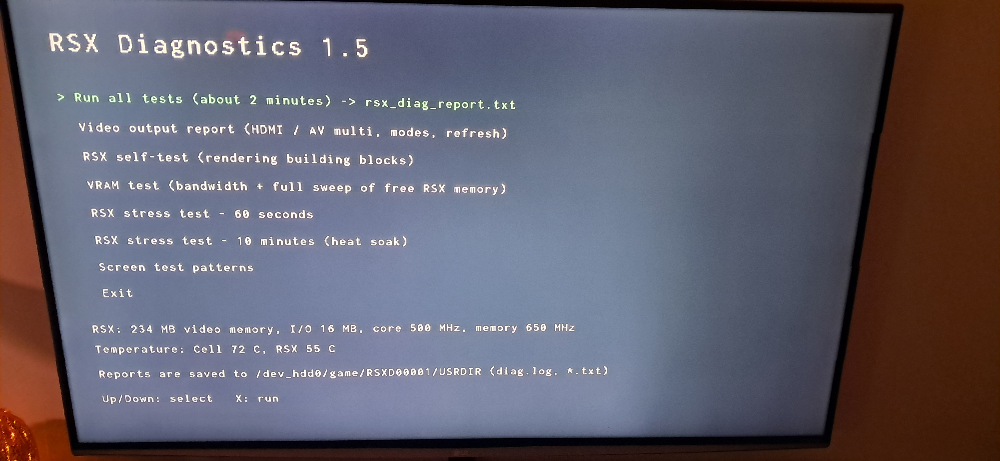

# PS3 system diagnostics tests 1.12

# Update 19.11.2026
- **Added new diagnostics based on TestBench FW**
- **Renamed the app to `PS3 System Diagnostics` and assigned it title ID `SYSD00001`.**

The new diagnostics use GameOS APIs and draw on research into **Sony’s PS3 TestBench firmware** and logs captured from two consoles.

| Diagnostic | What changed | Report |
| --- | --- | --- |
| **Cell–RSX IOIF** | Added linear and strided XDR-to-XDR RSX DMA, Cell-to-VRAM writes and reads with DMA in the opposite direction, and 64 XDR → VRAM → XDR round trips. The report identifies a mismatched word, flipped bits, or the transfer stage that timed out. | `sys_ioif_test.txt` |
| **Cell and XDR** | Added PPU integer, floating-point and VMX operations and eight cache-flushed pattern sweeps over 32 MiB of allocated XDR. | `cell_xdr_spu.txt` |
| **SPU local store and execution** | Added a 256 KiB local-store sweep for each raw slot GameOS allocates (up to five). The native payload checks SIMD arithmetic and runs 12 verified DMA round trips per slot using 128 B, 1 KiB and 16 KiB transfers. The PPU verifies both the transformed output and the guard words. | `cell_xdr_spu.txt` |
| **A/V test (based on TestBench FW)** | Added framebuffer CRC checks for color bars and a checkerboard, display flip checks, and a stereo sequence (left, right, both, silence). Check the received picture and sound on the display or receiver. The CRC is calculated before HDMI transmission. | `av_output_test.txt` |
| **Ethernet and peripherals** | Added GameOS wired link status and reported link type, directory reads on mounted USB storage, two checksum reads of a bundled HDD file, and Cell/RSX temperature readout. The HDD read may be cached. | `peripheral_test.txt` |

The **Video output report (settings)** reads the current display configuration. The **A/V test (based on TestBench FW)** runs framebuffer readback, display-flip and stereo playback checks.

### TestBench coverage that is left out

| TestBench area | Why it was left out |
| --- | --- |
| **HDMI transmitter programming, output CRC, and audio hardware diagnostics** | The app can verify its framebuffer and that GameOS consumed PCM. It has no transmitter register or capture interface for checking the serialized HDMI signal, audio clock switching, or DAC state. |
| **MPEG-2 decoding** | A reliable picture check could not be verified on hardware. |
| **Southbridge Ethernet, USB controller, PATA0, EBus and Southbridge IOIF internals** | GameOS exposes status and filesystem I/O. The build has no verified path to the controller-level test fixtures, raw bus test modes, or PHY loopback. |
| **SYSCON communication and thermal trip/clear** | The app reads temperatures. The original tests exercise the controller path and change thermal thresholds. The build has no verified GameOS interface for running those tests and restoring the original protection settings. |
| **Cell cache/coherency and low-level SPU cases** | The app checks allocated memory, normal execution and DMA through XDR. The original tests also cover SPU MMU and local-store-to-local-store transfers, wider instruction and channel suites, and deeper cache/coherency cases that require a different harness and more control over hardware state. |
| **IOIF CRC, ECC, retry and bus-error injection** | TestBench generates deliberate faults and checks hardware interrupt and recovery state. The GameOS build verifies normal transfers. The fault injection controls and status are outside the verified interface. |

# Previous first release (Named RSX Diagnostics):

A standalone PS3 app (title RSXD00001) for checking the RSX graphics chip, VRAM and the
video outputs. This can be useful if you suspect RSX to be failing in some way.

## Menu
- **Run all tests** (about 2 minutes): video report, self-test, VRAM test, 60 s stress test.
  Combined report: `rsx_diag_report.txt`.
- **Video output report**: connected port (HDMI, component, composite, SCART, D-sub...), port
  state (a port stuck "BUSY" is a bad sign), colour space, display latency, RGB range, the modes
  the TV reports (EDID) and its chromaticity data, HDCP receiver count, which resolutions
  (480/576/720/1080, the 1080 widths, 3D) the system will accept per aspect ratio, the current
  configuration, the measured vblank (refresh) rate and temperatures. `video_report.txt`.
- **RSX self-test**: each kind of RSX command on its own, then rendering checks with pixel
  readback (clears, coordinates, vertex colours, texturing, blending, depth, alpha test, stencil,
  shader combiners, image scaling) and a triangle throughput test. `rsx_selftest.txt`.
- **VRAM test**: CPU and DMA bandwidth, a 32 MB pattern test, a fill-rate test, then a sweep of
  every free byte of RSX memory: CPU-written address patterns and their inverse, RSX-written
  fills, all read back by DMA. Bad words are reported with offset (in MB) and flipped bits.
  Errors only in the RSX-written passes point at the RSX / memory interface, errors in all
  passes at the memory chips. `rsx_vramtest.txt`.
- **RSX stress test** (60 s or 10 min): keeps the RSX at full load (a 1280x720 target covered
  many times per frame by a ~200-instruction shader, blended and depth-tested, two frames always
  queued) and once a second renders a fixed check scene that must be bit-identical to the first.
  Mismatches or hangs that appear once the chip is warm are typical of a failing RSX. The report
  gives frames/s, megapixels/s and the start, highest and final temperatures. `rsx_stresstest.txt`.
- **Screen test patterns**: colour bars, ramps, 1-pixel checkerboard, grid, solid colours - to
  look for lines, blocks or colour errors on the TV.

Reports and `diag.log` are saved to `/dev_hdd0/game/RSXD00001/USRDIR/`; the log is also copied to
the first USB drive (`RSX_DIAG.log`) if one is plugged in.

Temperatures use lv2 syscall 383, which some firmwares do not allow; the report then says so.
A failed test is not proof of a hardware fault on its own - run it again, and compare with the
console cold and warm.

## WARNING: THIS IS EXPERIMENTAL TOOL , USE AT YOUR OWN RISK !!!
