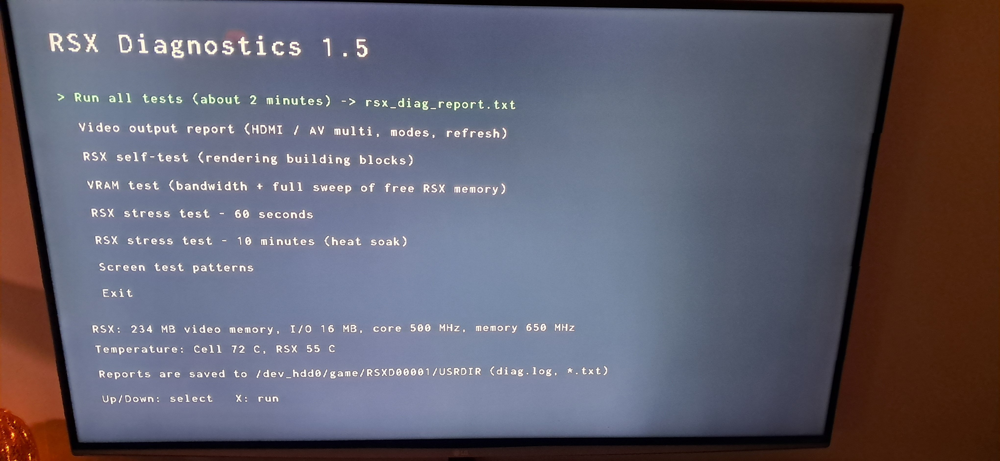

# RSX Diagnostics tests (experimental)

A standalone PS3 app (title RSXD00001) for checking the RSX graphics chip, VRAM and the
video outputs. This can be useful if you suspect RSX to be failing in some way.

## Menu
- **Run all tests** (about 2 minutes): video report, self-test, VRAM test, 60 s stress test.
  Combined report: `rsx_diag_report.txt`.
- **Video output report**: connected port (HDMI, component, composite, SCART, D-sub...), port
  state (a port stuck "BUSY" is a bad sign), colour space, display latency, RGB range, the modes
  the TV reports (EDID) and its chromaticity data, HDCP receiver count, which resolutions
  (480/576/720/1080, the 1080 widths, 3D) the system will accept per aspect ratio, the current
  configuration, the measured vblank (refresh) rate and temperatures. `video_report.txt`.
- **RSX self-test**: each kind of RSX command on its own, then rendering checks with pixel
  readback (clears, coordinates, vertex colours, texturing, blending, depth, alpha test, stencil,
  shader combiners, image scaling) and a triangle throughput test. `rsx_selftest.txt`.
- **VRAM test**: CPU and DMA bandwidth, a 32 MB pattern test, a fill-rate test, then a sweep of
  every free byte of RSX memory: CPU-written address patterns and their inverse, RSX-written
  fills, all read back by DMA. Bad words are reported with offset (in MB) and flipped bits.
  Errors only in the RSX-written passes point at the RSX / memory interface, errors in all
  passes at the memory chips. `rsx_vramtest.txt`.
- **RSX stress test** (60 s or 10 min): keeps the RSX at full load (a 1280x720 target covered
  many times per frame by a ~200-instruction shader, blended and depth-tested, two frames always
  queued) and once a second renders a fixed check scene that must be bit-identical to the first.
  Mismatches or hangs that appear once the chip is warm are typical of a failing RSX. The report
  gives frames/s, megapixels/s and the start, highest and final temperatures. `rsx_stresstest.txt`.
- **Screen test patterns**: colour bars, ramps, 1-pixel checkerboard, grid, solid colours - to
  look for lines, blocks or colour errors on the TV.

Reports and `diag.log` are saved to `/dev_hdd0/game/RSXD00001/USRDIR/`; the log is also copied to
the first USB drive (`RSX_DIAG.log`) if one is plugged in.

Temperatures use lv2 syscall 383, which some firmwares do not allow; the report then says so.
A failed test is not proof of a hardware fault on its own - run it again, and compare with the
console cold and warm.

## WARNING: THIS IS EXPERIMENTAL TOOL , USE AT YOUR OWN RISK !!!
